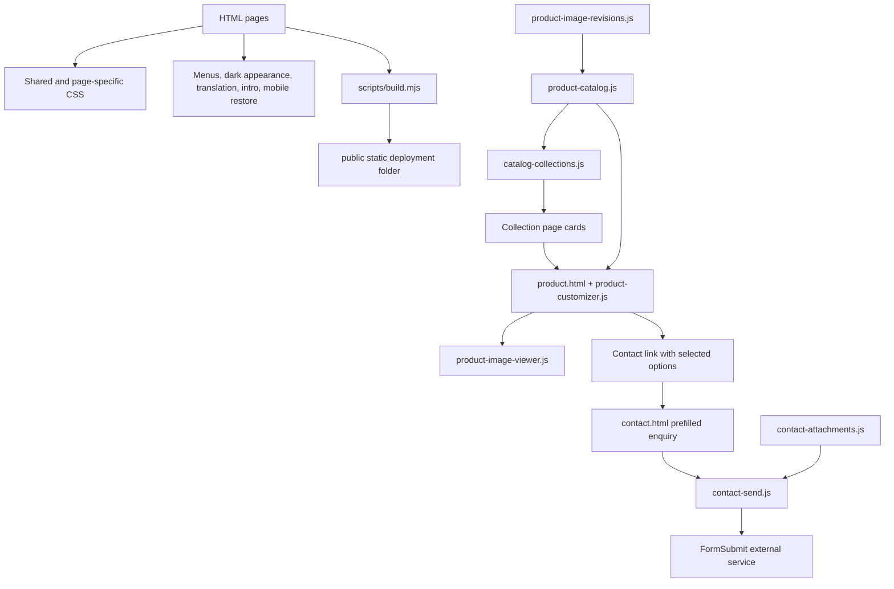

# Opium Bite — developer handoff

This is the source code for the Opium Bite custom jewelry website. This guide explains where each part lives, how the files work together, and how to continue development.

**Repository:** [Tzanidakis/OpiumBite](https://github.com/Tzanidakis/OpiumBite)  
**Source folder used for this handoff:** `testOpium`  
**Documentation reviewed:** 4 November 2026, after the blue UV design and catalog update.

The project is a static, multi-page website built with plain HTML, CSS, and browser JavaScript. There is no React application, application server, database, account system, shopping cart, or checkout in this repository. Visitors browse products, select options, and send an enquiry through an external form service. Node.js is used for building and testing, not for serving production requests.

## Contents

- [Start locally](#start-locally)
- [How the project connects](#how-the-project-connects)
- [HTML pages](#html-pages)
- [JavaScript files](#javascript-files)
- [Stylesheets](#stylesheets)
- [Product data and enquiry flow](#product-data-and-enquiry-flow)
- [Shared browser contracts](#shared-browser-contracts)
- [Media and external services](#media-and-external-services)
- [Build and deployment](#build-and-deployment)
- [Tests](#tests)
- [Common development tasks](#common-development-tasks)
- [Unused-code cleanup record](#unused-code-cleanup-record)
- [Known limitations and handoff checks](#known-limitations-and-handoff-checks)

## Start locally

Use **Node.js 22 or newer**. Run commands from the repository root:

```sh
npm run build
npm test
python3 -m http.server 8081 --directory public
```

Open [http://localhost:8081/](http://localhost:8081/). Python is only a convenient local static server; another static server can be used instead.

The build and test scripts use Node's built-in modules, so these commands do not require installing npm packages. For the Cloudflare development tooling recorded in `package-lock.json`, install with `npm ci`.

Edit the HTML, CSS, and JavaScript files in the repository root, then rebuild and reload. There is no watch mode or automatic browser refresh. **Do not edit `public/` directly:** the next build deletes and recreates it. The local server does not emulate Cloudflare's extensionless redirects, custom response headers, or 404 handling; locally, use links such as `/classic.html` and `/product.html?id=classic-six`.

The current build produces **76 files**, generates **32 sitemap URLs**, and passes **82 automated tests**. These counts describe this revision, not a permanent target.

## How the project connects

Each HTML file is a separate page. Shared scripts attach behavior to IDs, classes, and `data-*` attributes in those pages. Most scripts use private function scopes and expose a small number of `window` APIs where another file needs them. There is no bundler resolving dependencies: the order of `<script>` tags matters.



Typical dependency order:

1. Every page declares `data-theme="dark"` directly on `<html>`. `page-entry.js` and `mobile-lifecycle.js` run early in the document head to prepare navigation/restore behavior. There is no theme switch or saved-theme dependency.
2. Deferred scripts run after HTML parsing. Load `translation-data.js` before `translation.js`.
3. Load `product-image-revisions.js` and `product-catalog.js` before catalog consumers such as `catalog-collections.js` and `product-customizer.js`.
4. On contact, load `contact-attachments.js` before `contact-send.js`.
5. Initialization registered on `DOMContentLoaded` then connects controls to the parsed page. Script registration order also affects the order of these callbacks.

Many files intentionally return without doing anything when their target elements are absent. A script being included on a page does not mean every feature in that script is active there.

## HTML pages

| File | Role and connections |
| --- | --- |
| [`index.html`](index.html) | Homepage: logo introduction, campaign hero, collection links, scroll-controlled making-of film, custom-piece call to action, partner locations, and FAQ. Uses `animations.js` and `atelier.js` alongside shared scripts. |
| [`about.html`](about.html) | Brand, process, and FAQ content. Uses the inside-page styling and reveal behavior. |
| [`contact.html`](contact.html) | Enquiry form, topic controls, attachment picker, contact details, and FAQ. Inline JavaScript reads product information from the query string and prefills the message. Uses both contact scripts and `inside-pages.js`. |
| [`grillz.html`](grillz.html) | Grillz overview with links to the Classic, Iced Out, and Opium collections. |
| [`classic.html`](classic.html) | Catalog listing with `data-catalog-category="classic"`; cards come from `catalog-collections.js`, sorted by ascending silver starting price. |
| [`capital-custom.html`](capital-custom.html) | Publicly labeled **Opium**, despite its older filename. Lists catalog products with category `opium`, sorted by descending silver starting price. |
| [`earrings.html`](earrings.html) | Catalog listing with category `earrings`. Existing anchor IDs also support older links. |
| [`necklaces.html`](necklaces.html) | Publicly labeled **Pendants**; its catalog category is still `necklaces`. |
| [`iced-out.html`](iced-out.html) | Currently a Coming soon collection page. It includes catalog-related scripts, but has no active `data-catalog-category` listing. Iced Window currently belongs to the Opium catalog group. |
| [`product.html`](product.html) | Shared product-detail shell. A recognized `id` is handled by the catalog customizer. An inline legacy fallback handles older name/price/image/category query links. Includes the photo zoom viewer. |
| [`404.html`](404.html) | Explicit missing-page document, with `noindex`. Included in the build to avoid Cloudflare Pages treating missing paths as an SPA route. |

Header, footer, links, and some styles/behavior are repeated in HTML files. There is no template engine generating shared markup. A shared navigation or contact-detail edit may require updating multiple pages.

## JavaScript files

| File | What it does and what depends on it |
| --- | --- |
| [`site-chrome.js`](site-chrome.js) | Shared header/menu behavior: current-page highlighting, shrinking header, mobile drawer, focus handling and Escape, nested collection disclosures, and language control placement. Protects new-window links; catalog cards use native accessible anchors. Uses the header/nav markup and reacts to language changes. |
| [`page-entry.js`](page-entry.js) | Explicit browser refresh starts at the top and removes the fragment anchor. A valid mobile lifecycle return is exempt, so its saved position can be restored. Does not force ordinary links or cached back navigation to the top. |
| [`mobile-lifecycle.js`](mobile-lifecycle.js) | Handles phone/tablet suspension, lock/unlock, visibility changes, and discarded pages. Saves position, scroll containers, open details, and focus; can reload after return and restore the page. Avoids automatic reload when unsaved form work or an active operation is detected. Owns its recovery loader and bounded completion timers. |
| [`opening-intro.js`](opening-intro.js) | Opening logo image, smoke/caption interaction, dismissal and automatic exit. Creates an intro for direct inner-page openings when needed. Uses visit state to skip repeat internal navigation/reload intros and coordinates mobile loading with lifecycle restore. The intro is an image animation, not video. |
| [`animations.js`](animations.js) | Homepage scroll-controlled film: translates scroll position into video seeking and copy transitions; pauses work offscreen/while hidden; primes and recovers suspended media and provides a user playback fallback. Also handles homepage section highlighting and same-page navigation. The unused typewriter and old carousel were removed. |
| [`featured-products.js`](featured-products.js) | Populates the homepage signature carousel with eight real grillz, catalog preview covers, silver starting prices, and silver-selected product links; updates price labels when language changes. Load before the DOMContentLoaded track controls in `atelier.js`. |
| [`atelier.js`](atelier.js) | Editorial homepage enhancements: reveal effects, signature-card track controls, pointer effects, intro skip hookup when present, and the floating Create your piece link. The unused finish-selector component was removed; the current homepage has no finish-selector markup. |
| [`inside-pages.js`](inside-pages.js) | About/contact reveal effects and pointer spotlights. On contact, keeps topic buttons synchronized with the subject field and updates the message character count. |
| [`collections.js`](collections.js) | Centers the current item in the phone collection navigation strip, adds optional collection reveal effects, and reveals focused cards for keyboard users. Does not provide product data. |
| [`product-catalog.js`](product-catalog.js) | Main product records, prices, categories, material photo lists, option normalization, quote lookup, cover/gallery lookup, listing order, preview covers, collection return routes, and versioned asset URLs. Exposes `window.OpiumProducts`; consumed by collection cards, product detail, tests, and build-time sitemap generation. |
| [`product-image-revisions.js`](product-image-revisions.js) | Maps original remote image URLs to revision values. `OpiumProducts.asset()` adds `?v=...` so replacement images can refresh without changing their object paths. Does not upload or change any remote image. |
| [`catalog-collections.js`](catalog-collections.js) | Finds a section with `data-catalog-category`, filters the catalog, and creates product cards with covers, starting prices, and product links. Refreshes labels on language changes. No matching section means no cards are created. |
| [`product-customizer.js`](product-customizer.js) | Resolves catalog `id`, builds material/color/karat and supported stone/length controls, renders prices and material galleries, updates the product URL and metadata, and creates the enquiry URL. Handles thumbnail selection and prevents a late image response from showing the wrong material. Runs only for recognized catalog product detail; the unreachable collection-summary branch was removed. |
| [`product-image-viewer.js`](product-image-viewer.js) | Makes `#product-img` open a modal photo viewer. Supports zoom, drag/pan, pinch, double tap, keyboard controls, close/focus restoration, and English/Greek labels. Uses the currently displayed product image. |
| [`translation-data.js`](translation-data.js) | English-to-Greek dictionary exposed as `window.OPIUM_TRANSLATIONS_EL`. Add shared translated strings here. |
| [`translation.js`](translation.js) | Creates the language control and `window.OpiumI18n`. Translates text and supported attributes, supports explicit `data-i18n-el` HTML, preserves original content and form input, observes dynamic changes, and broadcasts language changes. |
| [`cookie-consent.js`](cookie-consent.js) | Creates optional-cookie preference controls and a footer settings button; saves the choice and exposes `OpiumConsent.allowed()`. The current source does not load optional analytics/advertising tags. Any future integration must explicitly consult consent. |
| [`contact-attachments.js`](contact-attachments.js) | Attachment selection, drag/drop, removal, validation, and accessible status UI. Exposes selected files through `OpiumAttachments`. The unused MIME `.eml` draft generator was removed; enquiries use the direct-send flow. |
| [`contact-send.js`](contact-send.js) | Reads validated selected files, creates real multipart attachment inputs, marks the form busy, and submits it natively to FormSubmit. Restores usable controls when returning from the provider and preserves the form when attachment preparation fails. Does not itself confirm email delivery. |

### Inline code still matters

Not all logic is in separate `.js` files. In particular:

- `contact.html` reads `product`, `price`, and `details` query parameters, limits their lengths, and constructs a translated initial enquiry message.
- `product.html` has a fallback for unrecognized/missing catalog IDs, with bounded text and restricted image sources, plus category-specific legacy controls.
- Collection cards are native links created by `catalog-collections.js`. The obsolete inline click handlers were removed because catalog cards always bypassed them and Coming soon pages contained no cards.

Search `<script>` blocks when tracing a feature; avoid adding a second handler for something already handled inline.

## Stylesheets

CSS is layered through multiple `<link>` tags and inline `<style>` blocks. Later rules, selector specificity, media queries, and `!important` all affect the final appearance. Inspect browser computed styles before deciding where an override belongs.

| File | Responsibility |
| --- | --- |
| [`styles.css`](styles.css) | Original shared foundation: page layout, header/navigation, intro, homepage sections, cards, footer, responsive behavior, and general accessibility rules. |
| [`atelier.css`](atelier.css) | Editorial design layer: colors, campaign heroes, buttons, collection previews, signature track, floating enquiry link, intro decoration, and responsive overrides. Contains shared rules as well as homepage rules. |
| [`navigation.css`](navigation.css) | Later navigation overrides, including phone menu layout, dropdown disclosures, preference controls, and current-page presentation. Coordinate changes with `site-chrome.js`. |
| [`collection-header.css`](collection-header.css) | Header layout/spacing for pages using `collection-page`, including product detail. |
| [`collections.css`](collections.css) | Collection title/navigation strip, editorial cards/grid, Coming soon and commission sections, reveal states, and phone layout. |
| [`inside-pages.css`](inside-pages.css) | About/contact editorial sections, campaign imagery, enquiry layouts, and inside-page responsive behavior. |
| [`contact-styles.css`](contact-styles.css) | Contact-specific form controls, contact items, attachment UI, status messages, and responsive foundation. Works with `inside-pages.css`. |
| [`product-customizer.css`](product-customizer.css) | Material/karat/stone/length controls, gallery thumbnails, image placeholders/captions, and variant notes. |
| [`product-image-viewer.css`](product-image-viewer.css) | Modal photo stage, zoom controls, panning interaction states, and viewer layout. |
| [`mobile-lifecycle.css`](mobile-lifecycle.css) | Refresh/restore overlay, loading states, and rules that prevent overlapping intro/restore UI. |
| [`translation.css`](translation.css) | Language button and layout adjustments for translated content. |
| [`theme.css`](theme.css) | Permanent dark surfaces, readable colors, native dark form controls, and blue UV accents. No switch is created. |
| [`cookie-consent.css`](cookie-consent.css) | Consent panel, action buttons, and footer preference control. |
| [`homepage-collections.css`](homepage-collections.css) | Homepage-only equal card grid, shared image frames, aligned labels/titles/captions, and responsive image sizing. Loaded after shared styles. |
| [`readability.css`](readability.css) | Final shared type-size layer, catalog carousel presentation, product back link, and compact phone/tablet product layout. All type-size selectors exclude the scroll-film text. |
| [`typography.css`](typography.css) | Final shared Cormorant Garamond typography rules, including localized content; preserves the dedicated Material Symbols font. Some rules intentionally use `!important`. |

Do not assume an older-looking rule is unused: inline styles and older shared rules still participate in the cascade. Keep script-dependent classes/IDs when restyling.

## Product data and enquiry flow

### Catalog records

The source of truth for recognized products is the `products` array in `product-catalog.js`. Important fields:

| Field | Meaning |
| --- | --- |
| `id` | Stable product URL key, for example `classic-six`. Also used by tests and sitemap generation. |
| `name`, `category` | Display name and listing category. Current active listing categories are `classic`, `opium`, `earrings`, and `necklaces`. |
| `currency` | Currency code; current prices use EUR. |
| `startingPriceMinor` | Starting price in cents: `54000` means €540. `null` means Ask for price. |
| `goldPriceMinor` | Gold starting-price lookup keyed by karat strings such as `"9"`, `"14"`, and `"18"`, also in cents. |
| `images` | Ordered photo URL arrays keyed by `yellow`, `rose`, and `silver`. Their order controls thumbnail order. |
| `covers` | Optional per-material cover override used by the cover helper. |
| `sourceFolder` | Original media folder mapping, useful for inventory checks and tracing remote assets. |
| `teeth` | Optional tooth count included in enquiry details. |
| `diamondOptions`, `lengthOption` | Enable stone selection and preferred length controls. |
| `priceExcludesDiamonds` | Adds the relevant price note and stone choices. Stone options are quoted separately. |

`selection(material, color, karat)` normalizes inputs. Materials are silver/gold; gold colors are yellow/rose/white; gold karats are 9/14/18. Silver clears gold-only choices. White gold currently uses silver photos as an explicit visual reference while retaining gold pricing. Selecting a stone or length does not calculate a new price.

### From collection to contact

1. A collection's `data-catalog-category` selects catalog records.
2. `catalog-collections.js` renders cards, using independent listing covers, with links such as `product.html?id=classic-six&material=silver`.
3. `product-customizer.js` reads the recognized ID and supported options, displays the correct gallery and starting price, and uses `history.replaceState` to keep selected options in the URL.
4. The enquiry button builds a `contact.html` URL carrying product identity, price, details, and supported options, followed by `#contact-form`.
5. Contact's inline script turns the display fields into an initial message. Visitors can edit it and add attachments.
6. `contact-send.js` submits the real form to the `action` in `contact.html`: `https://formsubmit.co/opiumbite@gmail.com`. CAPTCHA and delivery confirmation belong to the provider.

Query strings are visitor-controlled. The contact prefill is descriptive information, not a trusted order or verified price. Product price decisions must come from approved catalog data and a final business quote, never arbitrary URL text.

### Public product API

`window.OpiumProducts` exposes `products`, `classic`, `get(id)`, `selection(material, color, karat)`, `quote(state, product)`, `gallery(state, product)`, `image(state, product)`, `asset(url)`, `listing(category)`, `preview(product)`, and `collectionURL(category)`. The `classic` record is a compatibility default for helper calls that omit a product.

Use `asset()` when assigning catalog photo URLs so revision-based cache refresh continues to work. The build evaluates the catalog inside a minimal JavaScript sandbox with `window: {}`. Keep catalog initialization independent of the DOM, network calls, and browser-only work at load time, or update the build accordingly.

## Shared browser contracts

### APIs and events

| Contract | Producer and consumers |
| --- | --- |
| `window.OpiumImageRevisions` | Revision map read by `OpiumProducts.asset()`. |
| `window.OpiumI18n` | `t()`, `originalText()`, `refresh()`, `setLanguage()`, and `language`; used for dynamic labels, cards, options, and attachment messages. |
| `window.OpiumAttachments` | `validateFiles()` and a copied `files` list; submission reads it. |
| `window.OpiumContact` | Exposes `prepareAttachments(form, files)`; also exercised in submission tests. |
| `window.OpiumConsent` | `allowed()` returns whether optional tracking was accepted. |
| `opiumbite:language-change` | Emitted by translation code; listeners update menus, cards, product controls/gallery labels, viewer, and attachments. |
| `opiumbite:loader-finished` | Emitted when intro/restore loading releases the page; film recovery listens for it. |
| `opiumbite:restore-complete` | Emitted by mobile restore; intro and film recovery coordinate around it. |
| `opium:consent` | Consent change event with `detail.optional`. Note that its prefix differs from the other events. |

### Stored state

| Storage | Key | Purpose |
| --- | --- | --- |
| `localStorage` | `opiumBiteLanguage` | Saved English/Greek choice. |
| `localStorage` | `opiumBiteCookieConsent` | Versioned optional-cookie preference. |
| `sessionStorage` | `opiumBiteIntroVisitV3` | Intro visit state within a tab. |
| `sessionStorage` | `opiumBiteLifecycleStateV1` | Captured page state before suspension. |
| `sessionStorage` | `opiumBiteLifecycleRestoreV1` | Pending automatic restore context shared by page-entry and lifecycle code. |

Storage access is guarded so blocked storage does not break core controls. Preserve that behavior. Avoid changing restore-key names or timing rules in only one of the cooperating scripts.

### Important markup hooks

`#main-header`, the nav/hamburger markup, `#loading-screen`, `#bite-button`, `.hero-film` and its video/copy elements, `[data-catalog-category]`, `.product-container`, `body[data-product-page="true"]`, `#product-img`, `.product-right`, `#options-container`, `#contact-form`, `#attachments`, `#contact-form-status`, and `data-i18n-el` are behavioral hooks. Rename them only after updating consumers and relevant tests.

## Media and external services

| Location/service | Purpose and maintenance |
| --- | --- |
| [`media/`](media/) | Local campaign images, logos, collection imagery, poster frames, and video source/compatibility assets. WebP files are generally the optimized website versions; PNG/JPG originals and older media also remain. Check actual references before deleting anything. |
| `media/*.prompt.txt`, `media/diamond-campaign-prompts.txt` | Image-generation provenance/instructions. Reference material for future visual work, not executable code. |
| `https://media.opiumbite.com` | External product photos and some video files, documented as Cloudflare R2 media. GitHub does not contain the remote product-photo library. Paths are case sensitive and can include encoded spaces. |
| [`r2-inventory.json`](r2-inventory.json) | Snapshot of media object keys used by catalog consistency tests. It is not an upload command or live inventory sync. |
| Google Fonts / Material Symbols | External typography/icon styles referenced in HTML. Check layout and fallbacks when external fonts are unavailable. |
| FormSubmit | External multipart enquiry submission. Recipient/action and hidden subject/template fields live in `contact.html`. No mail-server credentials are required in the browser code. |
| Cloudflare Pages | Intended static deployment target; its settings are configured outside the source files. |

The **current** homepage film uses remote `v1-mobile.mp4` and `v4-mobile.mp4`, but uses local `media/v2-mobile.mp4?v=user-trim-1` for its middle clip. The build therefore includes that local clip. Chapter 3's old clip is not used in the current homepage. Older deployment notes describing all videos as remote are historical.

## Build and deployment

| File/folder | Purpose |
| --- | --- |
| [`package.json`](package.json) | Project name, minimum Node version, `npm run build`, `npm test`, and the Wrangler development dependency. |
| [`package-lock.json`](package-lock.json) | Locked npm dependency tree; use `npm ci` when those tools are needed. |
| [`scripts/build.mjs`](scripts/build.mjs) | Recreates `public/`, starts from an explicit HTML page list plus `_headers`, follows recognized local HTML/CSS/JS/media references, checks files and the 25 MiB per-file limit, and generates `robots.txt` and `sitemap.xml`. Sitemap uses `https://opiumbite.com` and catalog product IDs. |
| [`scripts/check-preview.mjs`](scripts/check-preview.mjs) | HTTP audit of a Pages preview: routes, built assets, invented-path 404, product redirect, and ranged remote video requests. Writes a JSON report under `output/`; creates no deployment. |
| [`scripts/upload-preview-assets.cjs`](scripts/upload-preview-assets.cjs) | Low-level Cloudflare asset uploader. Reads a short-lived upload JWT from stdin, hashes assets from `public/`, uploads missing objects, and writes `/tmp/opium-pages-manifest.json`. Requires resolvable `blake3-wasm`; it is not a normal npm script or a complete Pages deployment command. Never put a token in the repository. |
| [`_headers`](_headers) | Cloudflare static response headers: content-type sniffing protection, referrer policy, same-origin framing, and camera/microphone/geolocation restrictions. No CSP is currently configured here. |
| [`.gitignore`](.gitignore) | Excludes generated `public/`, local `output/` and `tmp/`, dependencies, Wrangler state, Mac metadata, and local credential files. |
| [`DEPLOYMENT.md`](DEPLOYMENT.md) | Deployment procedure and accumulated preview history. Later dated/source-specific changes supersede older descriptions. |
| `public/` | Generated deployment output, ignored by Git. Upload this folder, not the repository root. |
| `output/`, `tmp/` | Local previews, QA reports, backups, and scratch work; ignored and not expected in a fresh clone. |

The build copies files; it does not bundle, minify, transpile, generate templates, upload R2 assets, or deploy. Its reference discovery uses regular expressions, not a complete HTML/JavaScript parser. Dynamically constructed paths, unusual `srcset` references, or a new file extension may require explicit build support. Inspect generated output after adding assets.

For Cloudflare Pages Git builds, the intended settings are framework None, build command `npm run build`, output directory `public`, and Node 22+. Only the built folder should be published. Extensionless production paths and `.html` redirects are hosting behavior, not a client-side router.

Historical notes identify [the staging preview](https://staging.opium-bite-preview.pages.dev) as a Direct Upload project and say Git auto-deployment was not connected. A successful Git push alone does **not** verify a deployment or configure domain/hosting settings. Verify the actual Cloudflare project before publishing.

To run the optional preview audit after building:

```sh
mkdir -p output
node scripts/check-preview.mjs https://staging.opium-bite-preview.pages.dev
```

The audit still probes some older remote video filenames as compatibility checks. Its HTTP success does not prove contact delivery or physical-phone behavior. The normal `_headers` does not add preview `noindex`; historical preview packaging added that separately.

## Tests

`npm test` runs Node's built-in test runner on `tests/*.test.mjs`. Many tests use simulated DOM/browser objects or inspect source text; they are regression checks, not a replacement for browser testing.

| File | What it verifies |
| --- | --- |
| [`tests/site-smoke.test.mjs`](tests/site-smoke.test.mjs) | Page structure, unique IDs, local links/assets, named controls, fragment targets, script parsing, and About FAQ markup. |
| [`tests/deployment.test.mjs`](tests/deployment.test.mjs) | Builds output, checks allowed assets/limits and exclusions, SEO metadata/sitemap, and current local/remote film asset expectations. |
| [`tests/product-catalog.test.mjs`](tests/product-catalog.test.mjs) | Product pricing, normalization, material/gallery isolation, folder mappings, inventory coverage, revision URLs, and product-specific option rules. |
| [`tests/price-fixture.json`](tests/price-fixture.json) | Approved-price comparison data used by catalog tests. Review price changes against business requirements instead of blindly updating this fixture to silence failures. |
| [`tests/intro.test.mjs`](tests/intro.test.mjs) | Fresh/repeat visits, image introduction, dismissal, mobile loading, failed-load exit, and lifecycle ownership. |
| [`tests/mobile-lifecycle.test.mjs`](tests/mobile-lifecycle.test.mjs) | Suspension/return reloads and restore, unsaved-work/active-operation guards, desktop exemption, and stalled-loader recovery. |
| [`tests/page-entry.test.mjs`](tests/page-entry.test.mjs) | Explicit refresh starts at top, valid automatic restore survives, stale restore is discarded, and normal/back navigation stays usable. |
| [`tests/film-performance.test.mjs`](tests/film-performance.test.mjs) | Offscreen/hidden rendering limits, decoder recovery, playback priming/tap fallback, and film chapter structure. |
| [`tests/phone-ui.test.mjs`](tests/phone-ui.test.mjs) | Phone collection layout, thumbnail/no-arrow expectations, icon presentation, and current image-intro/video-film separation. |
| [`tests/translations.test.mjs`](tests/translations.test.mjs) | Greek/English switching, attribute/dynamic text translation, input preservation, blocked storage, category navigation, and contact prefill. |
| [`tests/theme.test.mjs`](tests/theme.test.mjs) | Every page starts dark with no theme-switch script; CSS declares native dark controls. |
| [`tests/contact-attachments.test.mjs`](tests/contact-attachments.test.mjs) | File limits/type validation, accepted Unicode filenames and reference formats, and rejection of executable files. Actual multipart attachment preservation is checked in the direct-send tests. |
| [`tests/contact-send.test.mjs`](tests/contact-send.test.mjs) | Real attachment preparation, single native submission, invalid-input preservation, and controls after returning from the provider. |

For a focused run, use for example `node --test tests/product-catalog.test.mjs`. Run the full suite before sharing a finished change. Deployment tests rebuild `public/` themselves.

## Common development tasks

### Change text, branding, or contact details

Edit the relevant HTML and any repeated header/footer copies. Add dictionary entries to `translation-data.js` for shared strings; use `data-i18n-el` when a whole formatted block needs an explicit Greek equivalent. Dynamic JavaScript-generated text should call `OpiumI18n.t()` and refresh/listen for language changes as needed. Test both languages without overwriting visitor-entered form content.

### Add a catalog product

1. Add an approved record in `product-catalog.js`, using a unique stable ID, correct cents-based prices, category, and ordered material photo URLs.
2. Upload/verify the photos separately on the media host. Preserve exact case and encoded folder names. Update `r2-inventory.json` when changing the inventory represented by the tests.
3. An existing catalog-driven category lists the product automatically. A new category needs a matching HTML section with `data-catalog-category` and `.product-container`, correct script dependencies, and navigation links.
4. For a new page, update the explicit page list in `scripts/build.mjs` and relevant page/test lists and metadata. Current Coming soon pages will not start showing products just because a record was added.
5. Add meaningful price/gallery/option coverage, then test the product link, every material, enquiry prefill, and language changes. Catalog IDs are also added to the sitemap by the build.

### Change a price or product option

Edit catalog price fields in cents and confirm the change with the business price source. Update price fixtures only for approved changes. Stone and preferred-length controls are currently enquiry details, not price multipliers. New option types require coordinated changes to the customizer, URL handling, enquiry details, translations, and tests.

### Replace a photo

For local campaign art, update the referenced media file or path in HTML/CSS. Keep transparency where applicable and retain appropriate dimensions/poster behavior. For remote product photos, update the catalog paths or bump that URL's value in `product-image-revisions.js` after replacing the remote object. Test the cover, all thumbnails, material changes, and zoom viewer. Rebuild and check that required local media appears in `public/`.

### Change navigation or mobile behavior

Read `site-chrome.js`, `navigation.css`, `collection-header.css`, and the repeated HTML header markup together. Check phone drawer disclosures, focus/keyboard behavior, current-page state, and placement of the language control. The navigation breakpoint is 768px; lifecycle device detection also covers tablets/coarse pointers and is a different decision.

For refresh/lock-unlock behavior, review `page-entry.js`, `mobile-lifecycle.js`, `opening-intro.js`, and film listeners in `animations.js` together. Preserve the loader ownership and bounded recovery paths so a stalled resource cannot trap the visitor behind the overlay.

### Add a page or deploy a change

Copy a suitable existing page, keep required shared hooks and load order, set unique metadata/canonical, update shared navigation where appropriate, and add it to build/test page lists. Build and inspect `public/`, run tests, then verify the intended Pages preview. Hosting configuration and R2 uploads are separate from committing source changes to GitHub.

Asset `<script>`/`<link>` URLs often have `?v=...` suffixes. Keep all relevant page references consistent when bumping a shared asset version; the build removes query strings when locating source files, while browsers use them for cache identity.

## Current design and catalog behavior — 4 November 2026

- The homepage action is **Make it custom**. Only Grillz, Earrings, and Pendants appear in its category cards. The old Rings and Bracelets pages and their unreferenced category images were deleted and their routes removed from the build, menus, collection navigation, copy, and sitemap. Stored recently-viewed entries from those categories are filtered out.
- Grillz subcategories are ordered **Opium → Classic → Iced Out** in both the overview cards and menus. `listing('classic')` returns prices ascending; `listing('opium')` returns prices descending. Equal-price records retain their source order. Null/unknown prices sort last.
- `preview(product)` selects the gold cover only for WINDOW x STAR, DOWN BAR, 1 CAP, CROSS GRILL, FILTER CAP, UZI, XO, and PUSSY. Other products retain silver covers. Both collection cards and the homepage carousel still show silver starting prices and link with `material=silver`. The material galleries and price data themselves are unchanged.
- The homepage signature section contains eight real grillz links generated by `featured-products.js`; arrows, keyboard controls, and swipe scrolling are provided by the existing track in `atelier.js`. Keep its progress indicator synchronized if the curated product count changes.
- Every product has a real **Back to products** arrow. Catalog products use `collectionURL(category)`, with a safe Grillz fallback for unknown/legacy categories. No browser-history assumption is required.
- `readability.css` loads last on every page. Phones use a smaller product image and a single horizontal thumbnail row. Tablets use an image/options split. The old 180px product header gap is overridden with the actual navigation height.
- All pages use dark appearance with electric blue UV accents. `theme.js` and the theme button were removed. Old saved light preferences have no effect. The language toggle remains.
- Text sizes were increased across pages while excluding `.hero-film` descendants. A browser comparison with the previous source confirmed unchanged scroll-film wording, font sizes, and line heights at desktop and phone widths.
- The three regenerated image masters and optimized WebP assets are recorded in [the artwork prompts](media/nov4-artwork-prompts.md). The man-and-python image preserves the original right-side portrait/left-side copy composition. The pendant card uses the actual silver Opium Bite product design as reference.

Validation included 320px/390px phones and an 820px tablet: material controls were visible without scrolling; the 390px gold color and karat controls fit after choosing Gold. Classic and Opium ordering, gold-preview/silver-detail behavior, carousel navigation, collection return links, Greek labels, and absence of horizontal page overflow were checked. Physical-device lock/unlock and real email delivery remain separate acceptance work.

## Unused-code cleanup record

The following removals were traced against every current source page and browser script:

| Removed code | Evidence that it was inactive |
| --- | --- |
| Typewriter helper and its caret/blink styles | No runtime caller; the image intro sets its completed caption directly. The live `typing-complete` state is retained. |
| Old homepage carousel and dedicated styles | No `#carousel`, `.carousel-item`, or corresponding controls in current markup or generated elements. The separate signature track remains active. |
| Finish selector and dedicated styles | No `.finish-display`, `#finish-image`, or finish-option controls in current markup or generated elements. |
| MIME email-draft generator and retired status translations | No production caller; `contact-send.js` submits real multipart attachments to FormSubmit. Tests that only exercised the retired generator were removed. |
| Seven collection inline click handlers and shared legacy card key handler | Every current generated product card carries `data-catalog-product` and bypassed these handlers; Coming soon pages have no product cards. Native catalog links remain keyboard accessible. |
| Product-customizer collection-summary branch | The script is loaded only on product detail, which contains no collection summary card. The recognized-ID detail flow remains. |
| Old gallery-arrow/material-label and obsolete card-control styles | No current markup or script creates those controls. Thumbnail navigation and photo zoom remain. |
| Opening-video pause calls and styles | The intro uses `#opening-logo`; no runtime source creates `#opening-video`. The homepage scroll-film videos remain. |
| Catalog script includes on the Iced Out placeholder page | The page has no `data-catalog-category` target or product cards. Its Coming soon content remains. |

Uncertain shared CSS, external integrations, source media, development tools, and the reachable legacy product URL fallback were deliberately retained. This is a conservative removal of verified inactive code, not a claim that static inspection can prove every remaining CSS rule is used in every browser state. Review future candidates against dynamic DOM creation, responsive states, stored history, and old external links before deleting them.

## Known limitations and handoff checks

- **Contact delivery:** the active flow uses FormSubmit, not the older mailto/`.eml` flow. Deployment history says recipient activation and an actual email delivery test were pending. This guide does not independently verify delivery; coordinate an intentional test with the owner before treating sending as accepted.
- **Attachments:** current browser validation allows up to five files, 10 MiB per file and 10 MiB combined, from the extension allowlist in `contact-attachments.js`. Actual external-service acceptance still needs end-to-end verification.
- **Legacy product links:** unrecognized IDs can enter the old inline fallback. Avoid removing it until existing links and category-specific controls have been audited. A missing/invalid ID is not currently a dedicated product-not-found page.
- **Search metadata:** catalog product names/metadata are updated in browser JavaScript. Product-specific static HTML and separate indexed Greek/English routes are not generated. Changing language does not create another URL.
- **CSS/markup maintenance:** styles and HTML contain historical layers and repetition. Consolidation is possible future work, but requires cross-page visual checks and preservation of existing behavior.
- **Physical devices:** simulated tests cannot establish Safari/Android video decoding, real lock/unlock recovery, pinch gestures, or provider CAPTCHA behavior. Check actual phones after changes in those areas.
- **Deployment history:** `DEPLOYMENT.md` contains accumulated snapshots, including older counts and superseded UI decisions. Use the current source and tests for present behavior and verify live state separately. Local `output/` screenshots/reports mentioned there are intentionally absent from a normal clone.
- **External access:** continuing development may require owner-provided access to Cloudflare Pages, the R2 media library, and the receiving email inbox. The repository contains code and media references, not those account permissions.

Before handing over a release, check all collection routes, at least one full product/material/gallery/enquiry flow, both languages and the fixed dark appearance, phone navigation, intro dismissal, refresh and lock/unlock, keyboard access, missing-page status, and the generated deployment contents. Record any remaining acceptance work with the change.


### Blue UV palette refinement

The user supplied a blue UV-light reference after the original purple update.
Current accents use electric blue `#6e8bff` and `#5275ff`, cobalt glow `#304dff`,
and cyan highlight `#78dbff`; the dark surfaces now have a blue-black tint.
The four central tokens are in `theme.css`. Existing accent alpha values and
contrast differences are preserved across the shared and inline styles.
Photographic artwork retains its original colors.


### Homepage collection card alignment

All three collection links use the same markup: index label, 4:3 image frame,
then a title/caption block. `homepage-collections.css` owns their geometry.
Images fill an identical frame with a centered crop and no legacy masks or
blend effects. Cards keep equal padding and caption space; hover does not
move a card out of alignment. Desktop/tablet columns are equal, and phone
cards stack at a shared width.
